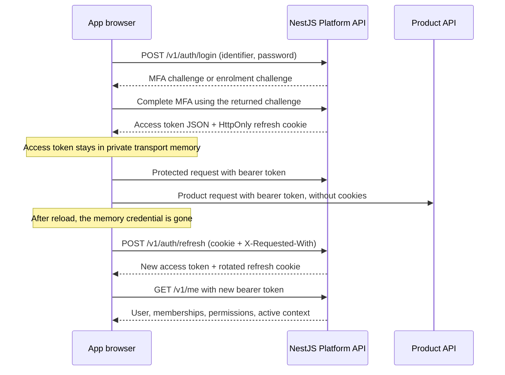

# Browser authentication against the current NestJS backend

The Platform API owns identity, backend sessions, refresh rotation, MFA, active
organisation context, and token issuance. Each browser app uses the shared
Platform transport. This implementation follows the existing password/MFA and
refresh-cookie contract; it does not require OAuth authorization-code endpoints.

## Request and credential flow



The Platform Axios client sends credentials and `X-Requested-With: healthalyst`.
The browser supplies `Origin`; application code never invents a browser Origin
header. Bodyless auth POST requests omit Content-Type as required by Fastify.
The refresh token is never read or written by frontend JavaScript.

`mfaToken` and `enrolmentToken` are short-lived credentials returned by the API,
not custom frontend cookies. The relevant workflow passes them to MFA verify,
TOTP setup, or TOTP confirm. Email verification may return an `enrolmentToken`;
there is no backend `authenticatorEnrolmentRequired` flag. Reloading an unfinished
MFA workflow returns the user to password sign-in; challenges are not persisted.

## Configuration

Copy each app's `.env.example` into its ignored `.env.local`.

| Variable                                          | Purpose                                                                          |
| ------------------------------------------------- | -------------------------------------------------------------------------------- |
| `NEXT_PUBLIC_HEALTHALYST_PLATFORM_API_URL`        | Browser Platform API origin, or `/` for a same-origin `/v1` proxy                |
| `HEALTHALYST_PLATFORM_API_URL`                    | Fixed upstream origin for that proxy; only needed when the public address is `/` |
| `NEXT_PUBLIC_TURNSTILE_SITE_KEY`                  | Public registration challenge key in the organisation hub                        |
| `NEXT_PUBLIC_HEALTHALYST_ORGANIZATION_APP_URL`    | Hub navigation destination in HealthSchedule                                     |
| `NEXT_PUBLIC_HEALTHALYST_SUPER_ADMIN_APP_URL`     | Super Admin destination for platform staff signing in through the hub            |
| `NEXT_PUBLIC_HEALTHALYST_HEALTH_SCHEDULE_APP_URL` | HealthSchedule destination after sign-in and in the hub's product launcher       |

Set the Super Admin destination to `http://localhost:3007` locally and to the
deployed Super Admin app address for deployed builds.

The public environment names and their URL/key validation live in
`@healthalyst/config`. The Platform API package owns the `/v1` rewrite and reads
the server-only `HEALTHALYST_PLATFORM_API_URL`. Keep each app's `.env.local` and
deployment values in that app's environment: the apps build and deploy
independently. `NEXT_PUBLIC_*` values are embedded in the browser bundle during
the build, so they must be set for the intended environment before building.

For local development against Render:

```dotenv
NEXT_PUBLIC_HEALTHALYST_PLATFORM_API_URL=/
HEALTHALYST_PLATFORM_API_URL=https://healthalyst-platform-api-dev.onrender.com
```

Next.js rewrites `/v1/:path*` to the fixed Platform origin, preserving API paths,
JSON bodies, and Set-Cookie headers. It does not replace credentials, hide access
tokens from JavaScript, or create frontend sessions. No Redis, encryption secret,
custom session cookie, or `/api/platform` route is involved. Restart the app after
changing these configuration values; rewrites and public variables are captured
by Next.js configuration/build processing.

### Deployed: one session through the hub

The live apps are the hub at `https://account.healthalystafrica.com`,
HealthSchedule at `https://healthschedule.healthalystafrica.com` and Super Admin
at `https://admin.healthalystafrica.com`. The hub keeps `/` and proxies `/v1` to
the Platform API, so the HttpOnly refresh cookie is set on the hub's host.
HealthSchedule and Super Admin set
`NEXT_PUBLIC_HEALTHALYST_PLATFORM_API_URL=https://account.healthalystafrica.com`
and leave out `HEALTHALYST_PLATFORM_API_URL`. All three refresh through
`https://account.healthalystafrica.com/v1/auth/refresh`; the apps are subdomains
of one site, so the `SameSite=Strict` cookie goes with each request and they
share one session. Every product's sign-in therefore depends on the hub's host
being available. A new product, such as LabConnect, uses the same setting, and
the hub's proxy must allow its origin with credentials.

A HealthAlyst page calling a Render hostname directly is cross-site; CORS alone
cannot make the Strict refresh cookie available, so always go through a
`healthalystafrica.com` host or a local proxy.

## Session and failure behavior

| Situation                                                  | Behavior                                                                                       |
| ---------------------------------------------------------- | ---------------------------------------------------------------------------------------------- |
| Reload or missing access token                             | One refresh, then `/v1/me`; concurrent restoration shares its pending operation                |
| Known access-token expiry                                  | Refresh before the next protected call                                                         |
| API returns `AUTH_TOKEN_EXPIRED`                           | Refresh and retry the rejected operation once                                                  |
| Invalid/revoked Platform session or invalid refresh cookie | Clear transport and identity state; the owning app handles sign-in navigation                  |
| Refresh network error, timeout, 403, 429, or server error  | Preserve a recoverable failure; do not pretend logout or loop                                  |
| Organisation or branch changes                             | Replace the token and restore identity; clear cached application data                          |
| Refresh changes the active context during an operation     | Reject the original operation rather than replay it for another organisation                   |
| Step-up succeeds                                           | Replace the access token before the sensitive action is retried by its workflow                |
| Logout, logout-all, or password reset succeeds             | Backend handles cookie/session termination; frontend clears its credential and cached identity |
| Password change succeeds                                   | The backend preserves the current session and revokes the others                               |
| Product audience is rejected                               | Refresh through Platform and retry once; preserve Platform authentication if still rejected    |

The private credential store uses a revision to discard a late refresh after
logout or a newer login/context change. Providers also ignore outdated
restoration results so they cannot overwrite a completed login or sign-out.
Ordinary token rotation does not invalidate a successful profile response. The
transport reads only the token subject as unverified metadata to detect a changed
account during shared-cookie refresh; it never uses decoded claims to authorize
requests. Backend token verification and `/me` remain authoritative. Neither a
malformed `/me` response nor a temporary outage is reported as an expired session. Access tokens are captured before auth services return safe
identity/context snapshots to workflow consumers.

## Hub and spokes

Each app has its own JavaScript runtime and query cache. Tokens are not passed
through URLs, shared browser storage, or imports from another app. The hub and
HealthSchedule both sign people in, with the shared `SignInForm` and their own
validation and workflow; either sign-in sets the same refresh cookie on the
hub's host, so the other app is signed in too. An installed HealthSchedule on an
iPhone keeps its own cookies, separate from Safari, so it needs this in-app
sign-in once per device. Account set-up and recovery stay in the hub. An API-calling
spoke recovers its own access token from Platform refresh when the backend cookie
is available, then uses a separate product Axios client. Product requests do not
send Platform cookies or implement their own refresh endpoint. The backend
checks organisation membership, realm, status, permissions, and token audience.

A browser cookie is scoped by host and path, not port. On localhost the three app
ports can therefore share the API refresh cookie. Signing in as a different user
or changing the server-side context can affect the identity/context recovered by
another app. Use separate browser profiles when testing independent organisation
and Super Admin accounts simultaneously. Do not assume separate ports isolate
backend sessions. Deployed apps share the session the same way, through the hub's
`/v1` (above); the hub's product launcher and organisation switcher handle moving
between apps and organisations, and there is no OAuth SSO hand-off.

HealthSchedule has one client for the HealthSchedule API, in
`apps/health-schedule/src/infrastructure/api`. Its address,
`NEXT_PUBLIC_HEALTHALYST_HEALTH_SCHEDULE_API_URL`, is either the API origin or
this app's proxy path, `/health-schedule-api`. Use the proxy: the API does not
accept browser `PATCH`, `PUT` or `DELETE` requests from other origins, and
deployed hosts may not be on its origin list. `HEALTHALYST_HEALTH_SCHEDULE_API_URL`
is the proxy's fixed target. Before opening the workspace, HealthSchedule calls
its own `GET /v1/organization`; a `PRODUCT_NOT_ENABLED` or product-audience
refusal shows a "still being set up" notice with a retry, because approval can
reach HealthSchedule a little after the Platform API lists the product.

HealthSchedule requests name their branch. The workspace keeps the chosen
branch in the app, from the open branches in the session's `branchIds` scope,
and remembers it per person and organisation on this device. It does not switch
the session's branch through `/v1/auth/context`, because that narrows the
token's branch scope to one branch and would hide the others from the picker.
Listing branches needs `branch:read`, which every preset role has.

## Sources

- The [Platform Swagger reference](https://healthalyst-platform-api-dev.onrender.com/docs/swagger/?urls.primaryName=Platform)
  is the source of truth for the API.
- [Axios interceptors](https://axios-http.com/docs/interceptors).
- [MDN Set-Cookie](https://developer.mozilla.org/en-US/docs/Web/HTTP/Reference/Headers/Set-Cookie),
  including credential, host/path, Secure, and SameSite behavior.
- Installed Next.js 16.3.8 rewrites/environment documentation and Turborepo 2.11.7
  environment documentation were used for configuration changes.
