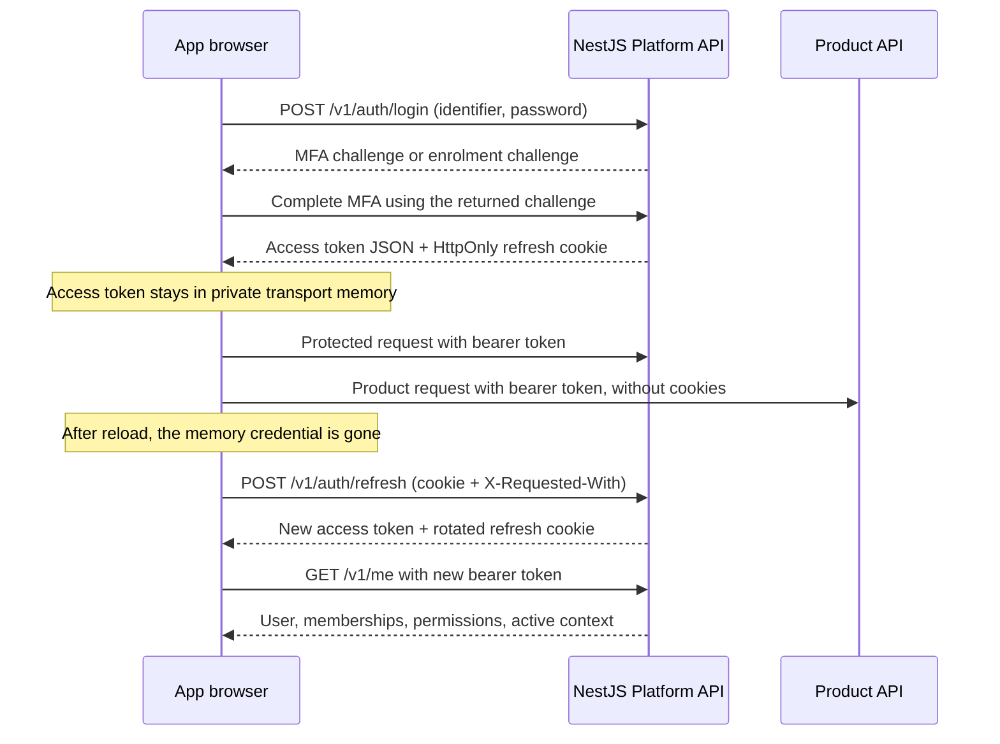

# Browser authentication against the current NestJS backend

The Platform API owns identity, backend sessions, refresh rotation, MFA, active
organisation context, and token issuance. Each browser app uses the shared
Platform transport. This implementation follows the existing password/MFA and
refresh-cookie contract; it does not require OAuth authorization-code endpoints.

## Request and credential flow



The Platform Axios client sends credentials and `X-Requested-With: healthalyst`.
The browser supplies `Origin`; application code never invents a browser Origin
header. Bodyless auth POST requests omit Content-Type as required by Fastify.
The refresh token is never read or written by frontend JavaScript.

`mfaToken` and `enrolmentToken` are short-lived credentials returned by the API,
not custom frontend cookies. The relevant workflow passes them to MFA verify,
TOTP setup, or TOTP confirm. Email verification may return an `enrolmentToken`;
there is no backend `authenticatorEnrolmentRequired` flag. Reloading an unfinished
MFA workflow returns the user to password sign-in; challenges are not persisted.

## Configuration

Copy each app's `.env.example` into its ignored `.env.local`.

| Variable                                       | Purpose                                                                          |
| ---------------------------------------------- | -------------------------------------------------------------------------------- |
| `NEXT_PUBLIC_HEALTHALYST_PLATFORM_API_URL`     | Browser Platform API origin, or `/` for a same-origin `/v1` proxy                |
| `HEALTHALYST_PLATFORM_API_URL`                 | Fixed upstream origin for that proxy; only needed when the public address is `/` |
| `NEXT_PUBLIC_TURNSTILE_SITE_KEY`               | Public registration challenge key in the organisation hub                        |
| `NEXT_PUBLIC_HEALTHALYST_ORGANIZATION_APP_URL` | Hub navigation destination in HealthSchedule                                     |
| `NEXT_PUBLIC_HEALTHALYST_SUPER_ADMIN_APP_URL`  | Super Admin destination for platform staff signing in through the hub            |

Set the Super Admin destination to `http://localhost:3007` locally and to the
deployed Super Admin app address for deployed builds.

The public environment names and their URL/key validation live in
`@healthalyst/config`. The Platform API package owns the `/v1` rewrite and reads
the server-only `HEALTHALYST_PLATFORM_API_URL`. Keep each app's `.env.local` and
deployment values in that app's environment: the apps build and deploy
independently. `NEXT_PUBLIC_*` values are embedded in the browser bundle during
the build, so they must be set for the intended environment before building.

For local development against Render:

```dotenv
NEXT_PUBLIC_HEALTHALYST_PLATFORM_API_URL=/
HEALTHALYST_PLATFORM_API_URL=https://healthalyst-platform-api-dev.onrender.com
```

Next.js rewrites `/v1/:path*` to the fixed Platform origin, preserving API paths,
JSON bodies, and Set-Cookie headers. It does not replace credentials, hide access
tokens from JavaScript, or create frontend sessions. No Redis, encryption secret,
custom session cookie, or `/api/platform` route is involved. Restart the app after
changing these configuration values; rewrites and public variables are captured
by Next.js configuration/build processing.

For direct deployed requests, set the public variable to the actual HTTPS
Platform API origin and omit the proxy target. The apps and API must be on the
same site for the API's `SameSite=Strict` refresh cookie. For example, app
subdomains and `platform-api.dev.healthalystafrica.com` can use this arrangement
when the backend allows their exact origins. A HealthAlyst page directly calling
a Render hostname is cross-site; CORS alone cannot make the Strict refresh cookie
available. Use the documented proxy until the same-site API origin is configured.

## Session and failure behavior

| Situation                                                  | Behavior                                                                                       |
| ---------------------------------------------------------- | ---------------------------------------------------------------------------------------------- |
| Reload or missing access token                             | One refresh, then `/v1/me`; concurrent restoration shares its pending operation                |
| Known access-token expiry                                  | Refresh before the next protected call                                                         |
| API returns `AUTH_TOKEN_EXPIRED`                           | Refresh and retry the rejected operation once                                                  |
| Invalid/revoked Platform session or invalid refresh cookie | Clear transport and identity state; the owning app handles sign-in navigation                  |
| Refresh network error, timeout, 403, 429, or server error  | Preserve a recoverable failure; do not pretend logout or loop                                  |
| Organisation or branch changes                             | Replace the token and restore identity; clear cached application data                          |
| Refresh changes the active context during an operation     | Reject the original operation rather than replay it for another organisation                   |
| Step-up succeeds                                           | Replace the access token before the sensitive action is retried by its workflow                |
| Logout, logout-all, or password reset succeeds             | Backend handles cookie/session termination; frontend clears its credential and cached identity |
| Password change succeeds                                   | The backend preserves the current session and revokes the others                               |
| Product audience is rejected                               | Refresh through Platform and retry once; preserve Platform authentication if still rejected    |

The private credential store uses a revision to discard a late refresh after
logout or a newer login/context change. Providers also ignore outdated
restoration results so they cannot overwrite a completed login or sign-out.
Ordinary token rotation does not invalidate a successful profile response. The
transport reads only the token subject as unverified metadata to detect a changed
account during shared-cookie refresh; it never uses decoded claims to authorize
requests. Backend token verification and `/me` remain authoritative. Neither a
malformed `/me` response nor a temporary outage is reported as an expired session. Access tokens are captured before auth services return safe
identity/context snapshots to workflow consumers.

## Hub and spokes

Each app has its own JavaScript runtime and query cache. Tokens are not passed
through URLs, shared browser storage, or imports from another app. An API-calling
spoke recovers its own access token from Platform refresh when the backend cookie
is available, then uses a separate product Axios client. Product requests do not
send Platform cookies or implement their own refresh endpoint. The backend
checks organisation membership, realm, status, permissions, and token audience.

A browser cookie is scoped by host and path, not port. On localhost the three app
ports can therefore share the API refresh cookie. Signing in as a different user
or changing the server-side context can affect the identity/context recovered by
another app. Use separate browser profiles when testing independent organisation
and Super Admin accounts simultaneously. Do not assume separate ports isolate
backend sessions. Direct deployed apps that use the same API cookie also need
explicit account/context UX; this transport does not implement a product launcher
or an OAuth SSO handoff.

HealthSchedule currently provides hub navigation, not scheduling screens. The
shared product client factory supports the backend's bearer-token contract;
adding product workflows and their access screens remains separate work.

## Migration from the previous frontend session system

Existing frontend session cookies and Redis records are no longer used. The
browser must sign in once to receive the Platform API refresh cookie. After that,
page reloads restore through refresh and `/me`. Remove the old frontend Redis,
app-origin, encryption-secret, and refresh-cookie-name variables from deployment
configuration. Never copy old credential values into public variables.

## Verification on 24 October 2026

The transport/contract suite contains 61 passing tests. Frozen-lockfile install,
workspace lint/type checks, and all three production app builds passed. Formatting
of changed files passes; the repository-wide format command still flags the
pre-existing, unmodified `docs/BFF-guide.md` reference.

Browser checks used isolated contexts and simulated backend responses for
organisation password/MFA sign-in, reload, expired-token recovery, logout,
Super Admin realm activation/reload, rejection of non-staff access without global
logout, email confirmation/TOTP enrolment, recovery-code acknowledgement,
forgot/reset password, and retry after a temporary refresh failure. They verified
the HttpOnly/Secure/Strict cookie attributes, no credential persistence, and no
horizontal overflow on the checked 390-pixel mobile views. No page runtime
exceptions occurred in those scenarios. Authenticated deployed backend journeys
were not exercised with real accounts.

A reload regression check uses a JWT-shaped fixture with a user subject. It
reproduced a successful refresh followed by a frontend `AUTH_CONTEXT_CHANGED`
error before `/me` was sent. Initial identity establishment now proceeds; the
identity-change guard still applies to existing credentials and retried requests.
Desktop and 390-pixel browser checks confirmed direct `/application` entry and
reload restore without clicking Try again, with one refresh per reload and no
page runtime exceptions. These checks also used simulated backend responses.

A live read through the local proxy to Render returned `200` for reference
policies. Refresh without a valid credential returned the expected
`401 AUTH_REFRESH_INVALID`. Live refresh checks also accepted the three local
origins on ports 3005, 3006, and 3007, returning matching CORS origin headers and
the expected unauthenticated response. These establish transport connectivity and
failure handling, not successful live sign-in, email delivery, or business mutations.

## Sources

- Current backend `packages/contracts/src/auth.ts`, `auth.controller.ts`, and
  `auth/http.ts`; the [Platform Swagger reference](https://healthalyst-platform-api-dev.onrender.com/docs/swagger/?urls.primaryName=Platform)
  documents the deployed API.
- [Axios interceptors](https://axios-http.com/docs/interceptors).
- [MDN Set-Cookie](https://developer.mozilla.org/en-US/docs/Web/HTTP/Reference/Headers/Set-Cookie),
  including credential, host/path, Secure, and SameSite behavior.
- Installed Next.js 16.3.8 rewrites/environment documentation and Turborepo 2.11.7
  environment documentation were used for configuration changes.
