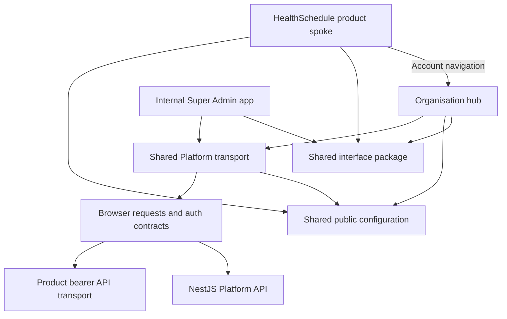

# Code organisation

This guide describes the implemented structure of the frontend. The monorepo
contains independently deployable apps; folders inside each app are organised by
the workflow they own. NestJS's useful principle carries over: keep a domain's
contracts, rules and operations together. Next.js route files still follow its
required naming and server/client conventions.

## App and package ownership



An app never imports another app's source. Product spokes navigate to the hub;
sharing code does not share their runtime, cookie host, session or query cache.
The NestJS backend remains the authority for permissions and business rules.

| Workspace               | Responsibility                                                                                          |
| ----------------------- | ------------------------------------------------------------------------------------------------------- |
| `apps/organization`     | Shared account authentication, registration, application status and organisation management integration |
| `apps/health-schedule`  | HealthSchedule product entry and future scheduling workflows                                            |
| `apps/super-admin`      | Platform staff authentication, workspace and organisation review                                        |
| `packages/config`       | Shared public environment names, parsing and validation                                                 |
| `packages/platform-api` | Stable Platform auth contract, browser transport and refresh lifecycle                                  |
| `packages/ui`           | Neutral shadcn primitives and reusable visual compositions                                              |
| `packages/icons`        | Semantic icon exports and the icon vendor dependency                                                    |
| Tooling packages        | Focused ESLint, TypeScript and test presets                                                             |

## Inside an app

```text
src/
  app/                       Thin Next.js route entries, layouts and handlers
  config/                    App routes and app-wide presentation settings
  components/ui/             Thin branded adapters over shared compositions
  features/
    <workflow>/
      components/            Render the workflow and bind its actions
      hooks/                 Coordinate workflow state and query lifecycle
      services/              Make requests, validate responses, translate errors
      schemas/               Zod validation for external and form data
      types/                 Domain/request types; infer schema-backed types
      config/                Endpoints, options, limits and presentation maps
      utilities/             Pure transformations owned by this workflow
  infrastructure/            App-wide auth/query providers and server adapters
  shared/<domain>/           App-local contracts genuinely used by multiple features
```

Create only folders that have a responsibility and actual code. A small feature
does not need all seven directories. Query keys live with the request services
they identify. Avoid adding an extra forwarding service between those requests
and the shared Platform package.

The organisation hub has four separate features: `authentication`,
`organization-registration`, `organization-application`, and
`organization-management`. Super Admin separates `staff-auth`, `staff-workspace`
and `organization-oversight`. HealthSchedule currently has `organization-access`.

### Dependency direction

```text
route → feature composition → workflow/query hook → request service
                    ↓                  ↓                  ↓
                 config          types / schemas      shared transport
```

Contracts and configuration do not import rendering, workflow hooks or request
services. ESLint enforces these direct imports and rejects cross-app source
imports. The Platform browser modules also reject imports of server modules,
Node.js built-ins and Redis. These rules supplement review; they do not resolve
every possible transitive dependency.

Keep a component's private properties next to the component. Move types when
they define a domain contract or have multiple consumers. Keep API schema keys
unchanged; use descriptive names for project-authored identifiers.

## What belongs in configuration

| Value                                                               | Owner                                                      |
| ------------------------------------------------------------------- | ---------------------------------------------------------- |
| Route destinations                                                  | App `config/routes.ts` or `config/application-routes.ts`   |
| Endpoint paths, allowed options, field limits, upload limits        | Owning feature `config/`                                   |
| Shared timeout, refresh margin, public requests and session signals | `platform-api/src/config/browser-config.ts`                |
| Public app origins, Platform API origin and validation              | `packages/config`                                          |
| Platform API fixed proxy target and rewrite                         | `packages/platform-api/next-config.mjs`                    |
| App route paths                                                     | Owning app `src/config/`                                   |
| Shared colours and interaction tokens                               | `packages/ui/src/styles.css` and its Tailwind preset       |
| Neutral reusable visual behaviour                                   | UI package `config/`                                       |
| One-off labels and local rendering choices                          | Owning view, unless several views share a presentation map |

`packages/config` is the shared source for public environment names and their
validation. Apps still own route paths, and each independently deployed app
keeps its own environment values. `packages/platform-api` owns the API rewrite
and reads its server-only proxy target. This centralises shared rules without
turning the package into a bucket for feature settings. Do not expose secrets
through public configuration or put auth credentials in browser storage.

## Shared packages

`platform-api/src/authentication` separates request services, response schemas,
types and endpoint configuration. The existing public `authentication-service`
import exposes that module without exposing its internal file layout.

`platform-api/src/browser` owns the Axios client, error translation, private
memory credential store, single-flight refresh, and bearer interceptors. The
Platform backend owns the HttpOnly refresh cookie. The package's
`next-config` export provides a fixed `/v1` transport rewrite for local/Render
use. It creates no frontend session and does not store credentials on the server.
Product API clients share their app's Platform credential lifecycle and send
bearer tokens without cookies. See [authentication](authentication.md).

`ui/src/primitives` holds the shadcn registry primitives, exported as
`@healthalyst/ui/primitives/*`. `ui/src/components` holds the dedicated
compositions built from them, exported as `@healthalyst/ui/components/*`.
Private form rendering
helpers live in `components/forms`, reusable form metadata in `types`, and form
operations in `forms`. Motion behaviour lives in a hook, with rotation defaults
in `config`. Components receive content and theme values from their apps.
The `ActionButton` remains the only consumer of the underlying button primitive.

Application code must consume dedicated shared compositions, never the shadcn
primitives directly. A composition owns its complete visual structure,
accessibility, and interaction states; an application supplies content, data,
business rules, and callbacks. Renamed primitive exports and pass-through wrappers
do not satisfy this boundary. `DataTable` owns table presentation and states,
while Super Admin supplies organisation column definitions and status labels.
`MetricSummary` owns the repeated metric presentation.

The shared stylesheet owns the palette for every app. Standard shadcn roles
reference the same surface, text, green, border and error values. The only extra
brand colours are `gold` and `gold-subtle`; use them directly rather than adding
alternate names or unused shade families.

The icon and tooling packages remain compact: they already have one focused
responsibility. Adding empty folder layers would make them harder to navigate.

## Adding a workflow or spoke

1. Choose the app that owns the user journey. Add a feature there, then a thin
   route that imports its page composition.
2. Put request/response contracts and configurable rules beside that feature.
   Use existing shared transport and UI exports.
3. Keep workflow state in a hook; keep response parsing in the request layer.
   Preserve loading, validation, permission, failure and recovery transitions.
4. Share code when consumers have the same stable responsibility. Use app-local
   `shared/<domain>` for multiple workflows in one app, a package for multiple apps.
5. A new spoke gets its own manifest, environment, routes, build and runtime.
   Account navigation points to the organisation hub; session handoff needs an
   explicit contract. A source import is not session handoff.

Run the required repository checks, review public exports and imports, and
exercise affected browser journeys when behaviour changes. Compilation alone
does not establish that a live API integration works.
