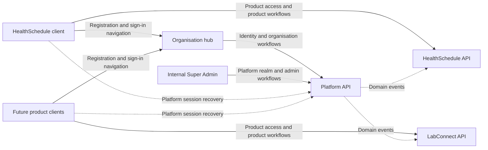

# HealthAlyst frontend architecture analysis

Review date: 23 October 2026. This is an analysis of the current working tree and API contracts, not an approved implementation specification.

## Evidence and scope

The frontend is on `feat/platform-registration`, with HEAD `51b8f96` and existing uncommitted changes. Those changes include the recently added application route and session provider. Their presence describes the implementation; it does not establish the intended architecture.

The review covers all three application workspaces, their routes, API clients, authentication and query providers, workflow components, configuration, all five shared package manifests and their responsibilities, shared compositions and exports, repository guidance, integration documentation, and continuous integration configuration. There are 64 application source files and 10 route entry points in the reviewed working tree. This is an architecture and contract review rather than an accessibility audit or a line-by-line review of every shared primitive.

The live API reference was authenticated using the credentials supplied for this conversation. Credentials and account data are excluded from this report. All three OpenAPI documents were retrieved directly from the deployed documentation:

| Document                                                                                             | Version | Paths | Operations |
| ---------------------------------------------------------------------------------------------------- | ------- | ----- | ---------- |
| [Platform](https://healthalyst-platform-api-dev.onrender.com/docs/platform.openapi.json)             | 1.0.0   | 77    | 88         |
| [HealthSchedule](https://healthalyst-platform-api-dev.onrender.com/docs/healthschedule.openapi.json) | 1.0.0   | 5     | 5          |
| [LabConnect](https://healthalyst-platform-api-dev.onrender.com/docs/labconnect.openapi.json)         | 1.0.0   | 5     | 5          |

Their paths and schemas match the corresponding checked-in documents in the local NestJS backend on branch `dev`, HEAD `4d04e31`. The backend's [frontend guide](/home/i19n/Documents/development/company/healthAlyst/healthalyst-backend/docs/frontend-guide.md) supplies the journey and environment explanations. A connected GitHub attempt to read that guide returned 404, so its remote revision was not independently verified.

No account login, registration, upload, review decision or other business mutation was performed during this analysis. The only live API checks beyond reading documentation were CORS preflight requests. Application code and configuration were left unchanged during this analysis.

## 1. The architecture

HealthAlyst has a shared organisation hub, independently deployed product spokes, and a separate internal administration client. All of them use a central Platform identity and organisation model. Product APIs implement their own business domains and consume platform events.



This diagram describes the ownership model implied by the existing hub links and documented API boundaries. Several integrations in it remain unimplemented. It does not imply that the current product APIs already expose scheduling or laboratory business workflows.

A monorepo shares source packages and tooling. Each Next.js app still has its own build, origin, root layout, React state and query cache. Mounting a provider in the organisation app cannot preserve a token in the HealthSchedule or Super Admin app. Navigation between apps therefore needs a deliberate session recovery and return-destination design.

### Application ownership

| Workspace                                                                                                                  | Owns                                                                                                                                         | Current implementation                                                                                                                                                        |
| -------------------------------------------------------------------------------------------------------------------------- | -------------------------------------------------------------------------------------------------------------------------------------------- | ----------------------------------------------------------------------------------------------------------------------------------------------------------------------------- |
| [Organisation hub](/home/i19n/Documents/development/company/healthAlyst/healthalyst-frontend/apps/organization/README.md)  | Common registration, verification and authentication; organisation onboarding; shared organisation administration and enabled-product access | Registration, email confirmation, MFA and recovery-code screens; a read-only application view; a basic in-memory provider                                                     |
| [HealthSchedule](/home/i19n/Documents/development/company/healthAlyst/healthalyst-frontend/apps/health-schedule/README.md) | Scheduling and clinical operations inside the selected, authorised organisation                                                              | A product entry page linking to the hub. No scheduling workspace or product API client yet                                                                                    |
| [Super Admin](/home/i19n/Documents/development/company/healthAlyst/healthalyst-frontend/apps/super-admin/package.json)     | HealthAlyst's internal organisation review, platform staff and lifecycle operations                                                          | Dashboard, organisation list and review UI using the older Java Accounts API contract                                                                                         |
| LabConnect / PharmaDesk                                                                                                    | Separate product spokes when implemented                                                                                                     | Product choices exist in registration. Neither has a frontend workspace. LabConnect has an API specification; no PharmaDesk specification is advertised by the live reference |

Organisation employees and HealthAlyst platform staff are different actors. `/v1/staff` and `/v1/roles` manage the selected organisation's employees and permissions. `/v1/admin/staff` manages HealthAlyst's own platform staff. Super Admin must use the `PLATFORM` realm; product APIs accept organisation product access rather than platform staff tokens.

### Shared packages

| Package                          | Responsibility                                                                                                                                          |
| -------------------------------- | ------------------------------------------------------------------------------------------------------------------------------------------------------- |
| `@healthalyst/ui`                | Product-neutral shadcn primitives and reusable compositions: action buttons, forms, dashboard shell, split-panel layouts, QR display and other controls |
| `@healthalyst/icons`             | Semantic icon exports; owns the Tabler dependency                                                                                                       |
| `@healthalyst/eslint-config`     | Shared lint rules and Next.js configuration                                                                                                             |
| `@healthalyst/typescript-config` | Shared strict compiler presets                                                                                                                          |
| `@healthalyst/test-utilities`    | Testing Library setup exposed for future consumers                                                                                                      |

There are five shared package workspaces and three application workspaces, for eight workspaces in total.

The installed application stack is Next.js 16.3.8, React 19.2.4, TypeScript 5.9.3 and Tailwind 3.4.19. pnpm 10.27.0 is pinned. Axios and TanStack Query are dependencies of the organisation and Super Admin apps. HealthSchedule currently needs neither because it only renders links. App manifests do not depend on other apps. Shared packages do not supply cross-application session persistence.

## 2. Current route inventory

Paths below are relative to each independent application origin.

| App            | Route            | Behaviour                                                                                                    |
| -------------- | ---------------- | ------------------------------------------------------------------------------------------------------------ |
| Organisation   | `/`              | Three-step registration and its check-email confirmation view; `?product=` preselects product interest       |
| Organisation   | `/verify-email`  | Email confirmation, resend and conditional MFA enrolment/recovery-code screens                               |
| Organisation   | `/sign-in`       | Password, authenticator/recovery-code challenge, conditional MFA enrolment and recovery-code acknowledgement |
| Organisation   | `/application`   | Recently added authenticated application display; redirects to sign-in when the in-memory session is absent  |
| HealthSchedule | `/`              | Product introduction with registration and sign-in links to the hub                                          |
| Super Admin    | `/`              | Redirects to `/dashboard`                                                                                    |
| Super Admin    | `/sign-in`       | Password-only legacy staff login                                                                             |
| Super Admin    | `/dashboard`     | Legacy organisation/review metrics                                                                           |
| Super Admin    | `/organizations` | Legacy registration list with client-side name filtering                                                     |
| Super Admin    | `/review`        | Legacy review queue, evidence requests and decisions                                                         |

The hub currently has no organisation/product home, organisation switcher, product launcher, profile/branch/role/member/partner routes, password reset route or invitation acceptance route. The last two are already named as frontend link destinations in the backend guide: `/reset-password?token=...` and `/invitations/accept?token=...`.

Moving the application display onto `/application` addresses its route placement. The next destination after sign-in still needs to be chosen from identity, context, organisation status and product access. An unconditional application redirect cannot represent the complete hub journey.

The new application layout still uses a centred `SplitPanelLayout` with the showcase disabled and a brand header. The authenticated hub needs a layout that supplies the selected organisation, relevant navigation, account controls and product destinations across its authenticated routes. The existing product-neutral dashboard composition is available for reuse; the hub's navigation and behaviour belong to the organisation app.

## 3. API ownership and current integration

| API area            | Operations | Frontend owner                                                                                | Current Platform integration                                                         |
| ------------------- | ---------- | --------------------------------------------------------------------------------------------- | ------------------------------------------------------------------------------------ |
| Auth                | 21         | Hub identity flows; common session contract also used by products and internal administration | Seven operations: login, MFA verify, setup, confirm, logout, verify email and resend |
| Onboarding          | 7          | Organisation hub                                                                              | Registration and application read                                                    |
| Reference           | 3          | Organisation hub                                                                              | Policy versions only; organisation types and states are currently bundled options    |
| Admin               | 16         | Super Admin                                                                                   | No Platform admin services; current services use legacy Accounts endpoints           |
| Organization        | 8          | Organisation hub                                                                              | No service/screens                                                                   |
| Roles               | 5          | Organisation hub                                                                              | No service/screens                                                                   |
| Staff               | 14         | Organisation hub, including invitee acceptance                                                | No service/screens                                                                   |
| Partners            | 10         | Organisation hub for common partnerships and discovery                                        | No service/screens                                                                   |
| Health / Operations | 4          | Operations/infrastructure                                                                     | Not applicant workflows                                                              |

There are 10 direct Platform operations implemented in the organisation app. This count is an integration inventory, not a requirement that every documented endpoint have a user-facing screen. JWKS, internal relay/events and health operations serve infrastructure purposes.

Each current product specification contains one user-facing product-access read (`GET /v1/organization`), one internal event ingestion operation and three health operations. The reviewed specifications do not yet provide appointment, patient, laboratory-order or result operations. Those business interfaces cannot be inferred from the product names.

## 4. Authentication and context must drive navigation

### The documented session

1. Password login returns `MFA_REQUIRED` or `MFA_ENROLMENT_REQUIRED`.
2. A valid second factor or confirmed enrolment creates a session, returns an access token, and sets the HttpOnly refresh cookie. Recovery codes are shown once and acknowledged before proceeding.
3. The access token stays in memory. Expiry is normally 10 minutes for organisation sessions and 5 minutes for platform staff tokens.
4. On reload or access-token expiry, recover through `POST /v1/auth/refresh`, using credentials and `X-Requested-With: healthalyst`. Refresh rotates the cookie; coordinate concurrent refresh calls.
5. Load `GET /v1/me` to rebuild the user, memberships, active context, permissions, branch scope and platform roles.
6. Choose organisation/branch through `POST /v1/auth/context`. A platform staff member can enter `{ realm: "PLATFORM" }`.
7. Step-up authentication issues a replacement token for sensitive actions. Logout also requires credentials so cookie removal is applied.

The backend auto-selects the organisation when there is exactly one membership. Several memberships start without an organisation context. Platform staff with no organisation memberships initially enter the platform realm. A person with both kinds of access needs an explicit realm choice when moving to internal administration.

### What the frontend currently loses

The [session response parser](/home/i19n/Documents/development/company/healthAlyst/healthalyst-frontend/apps/organization/src/features/organization-onboarding/api/platform-authentication-service.ts:28) retains the token, expiry, user names and memberships. It omits `activeContext`, `platformRoles` and `user.mfa`. Downstream code receives the parsed result and therefore loses those declared response fields. There is no `/v1/me`, refresh, context-switch or step-up service.

The [session provider](/home/i19n/Documents/development/company/healthAlyst/healthalyst-frontend/apps/organization/src/infrastructure/auth/platform-session-provider.tsx:21) only holds React state. It does not bootstrap a session on reload, recover an expired token or clear the query cache on identity/context change. The [HTTP client](/home/i19n/Documents/development/company/healthAlyst/healthalyst-frontend/apps/organization/src/features/organization-onboarding/api/platform-http-client.ts:23) explicitly uses `withCredentials: false`.

The previous description that reloading should end the session was incorrect for this backend contract. The in-memory access token is temporary; the refresh cookie is the mechanism for recovering it.

The [sign-in destination](/home/i19n/Documents/development/company/healthAlyst/healthalyst-frontend/apps/organization/src/features/organization-onboarding/components/sign-in.tsx:92) and email-verification completion currently always point to `/application`. Active organisation members and platform staff need different destinations and capabilities. The [multiple-membership view](/home/i19n/Documents/development/company/healthAlyst/healthalyst-frontend/apps/organization/src/features/organization-onboarding/components/organization-application-summary.tsx:75) displays a support message instead of selecting an organisation through the existing context API.

Passing an organisation ID into a query key does not select the API context. The bearer token identifies the organisation for `GET /v1/onboarding/application`.

## 5. The complete organisation journey

```text
Register -> confirm email -> enrol MFA -> acknowledge recovery codes
  -> selected organisation's DRAFT application
  -> complete profile, verify phone, upload/confirm required documents
  -> submit when canSubmit is true
  -> PENDING_VERIFICATION -> UNDER_REVIEW
       -> CHANGES_REQUESTED -> correct and resubmit
       -> REJECTED
       -> ACTIVE -> refresh identity/context -> enabled product access
```

The initial registration response is deliberately non-enumerating: `202 PENDING_EMAIL_VERIFICATION` does not confirm that an account was newly created. Verification and MFA do not submit the application for review.

The application API supplies `canEdit`, `canSubmit`, checklist items, document requirements, scan states and reviewer messages. The current screen displays the checklist, document states and messages. It parses `canEdit` and `canSubmit` but does not use them to expose working actions. Save, phone verification, upload, removal and submission operations are missing. The confirmation screen also jumps from MFA to review in its next-step copy, omitting application completion and submission.

`PENDING_VERIFICATION` means submitted and waiting for review in this lifecycle. The current description, “Confirm the administrator details to continue,” misrepresents that state.

Document upload has three distinct steps: request a presigned URL; PUT the file directly to storage using only its returned headers; confirm the document with Platform for validation and malware scanning. Product and Platform bearer credentials must not be attached to the storage request. Clean uploads, reviewer acceptance and a fully approved organisation are separate states.

Profile edits must preserve versions and send `If-Match`; `412` needs conflict recovery and `428` indicates a missing precondition. Backend `canEdit` and `canSubmit` should control the actions. Draft, requested-changes, submitted, under-review and final states need their corresponding reachable actions and recovery paths.

## 6. Product access is a separate transition

The [HealthSchedule links](/home/i19n/Documents/development/company/healthAlyst/healthalyst-frontend/apps/health-schedule/src/infrastructure/organization-app/organization-app-links.ts:26) pass `?product=healthschedule` during registration. The sign-in link has no originating-product or return destination, and there is no product launcher or return handling in the hub.

After authentication and organisation selection:

- An incomplete application opens its onboarding workspace.
- A submitted application shows review status and messages.
- An active organisation can open enabled products and common management functions according to permissions.
- Each spoke obtains a usable Platform session under the agreed cookie/origin strategy, then calls its product API's `GET /v1/organization` before opening product content.
- Platform staff use internal administration under the platform realm.
- Restricted/terminal organisation states need their status and permitted recovery paths.

After approval, the access token must be refreshed so its organisation status, permissions and product audiences reflect the new state. Product copies update through platform events, so brief synchronisation delay must be handled without presenting unconfirmed access as ready.

Product return routing and the deployment/session strategy are still design work. Any return URL should be constrained to known app destinations. The documented APIs do not establish a browser token-transfer protocol or permit tokens in URLs. Independent app origins cannot share a React provider.

## 7. Super Admin currently implements a different contract

The [staff authentication service](/home/i19n/Documents/development/company/healthAlyst/healthalyst-frontend/apps/super-admin/src/features/staff-auth/api/staff-service.ts) uses `/api/v1/staff/auth/session` and a legacy staff identity whose role must be `SUPER_ADMIN`. Its client obtains `X-XSRF-TOKEN` through `/api/v1/staff/auth/csrf`.

The [review service](/home/i19n/Documents/development/company/healthAlyst/healthalyst-frontend/apps/super-admin/src/features/organization-oversight/api/organization-service.ts:53) uses `/api/v1/staff/organization-registrations`, legacy evidence requests and statuses including `PENDING_REVIEW` and `APPROVED`. Its configured local backend is the Accounts API on port 8081.

The Platform contract instead uses the normal MFA identity flow, platform realm and platform roles; `/v1/admin/organizations`; cursor pagination; claim/release; checklist approval; itemised change requests; document view URLs; step-up; `If-Match`; and statuses including `PENDING_VERIFICATION`, `UNDER_REVIEW` and `ACTIVE`.

Changing only Super Admin's base URL cannot migrate those requests or response models. Until its services and journeys match Platform, the current hub registration and legacy review client do not form one documented end-to-end workflow. This is an incomplete migration rather than a reason to revive the previously rejected runtime backend switch.

## 8. Environment and operational evidence

| App            | Manifest port | Current relevant local target                                          |
| -------------- | ------------- | ---------------------------------------------------------------------- |
| Organisation   | 5173          | Deployed Render development Platform API                               |
| HealthSchedule | 5174          | Links to the organisation app at localhost:5173; no product API client |
| Super Admin    | 3007          | Legacy Accounts API at localhost:8081                                  |

All three Next.js configurations currently have standalone output and shared-package transpilation, with no API rewrite/proxy. The backend guide documents a `/v1` proxy for local or unrelated hosted domains, or compatible deployed frontend/API sites, because the refresh cookie is Secure, HttpOnly, SameSite=Strict and scoped to `/v1/auth`.

Live preflight evidence from this review:

| Target                            | Origin         | Result                                                                                              |
| --------------------------------- | -------------- | --------------------------------------------------------------------------------------------------- |
| Platform `/v1/auth/refresh`       | localhost:5173 | 204 with matching `Access-Control-Allow-Origin` and credentials allowed                             |
| Platform `/v1/auth/refresh`       | localhost:5174 | 204 without `Access-Control-Allow-Origin`; direct browser access is not authorised by that response |
| Platform `/v1/auth/refresh`       | localhost:3007 | 204 without `Access-Control-Allow-Origin`; direct browser access is not authorised by that response |
| HealthSchedule `/v1/organization` | localhost:5174 | Preflight timed out; product CORS/runtime availability unverified                                   |

The last two frontend ports therefore require consideration when Platform calls are added. A 204 preflight status alone does not establish browser permission. Enabling credentials alone also does not resolve the documented localhost-to-Render site mismatch; routing and cookie placement must be designed together. Deployment domains and browser cookie recovery were not verified in this review.

The error layer already understands Platform's nested errors, request references, field details and rate-limit messages. It lacks session-refresh recovery, context/realm recovery, step-up and actionable version-conflict handling. `Retry-After` currently becomes message text rather than a reusable retry deadline for controls.

## 9. Documentation and verification gaps

- The root README still assigns port 5173 and the Accounts API to HealthSchedule, although the manifests and actual source separate the organisation hub and HealthSchedule on 5173 and 5174.
- The root guidance contains historical Accounts API behaviour. Its conventions remain applicable; those backend descriptions do not describe the NestJS Platform contract.
- The integration plan contains a “one contract, no backend switch” decision alongside older switch proposals, obsolete frontend paths and an old progress snapshot. It should be consolidated against the actual migration state.
- The form-system document points at workflow paths removed from HealthSchedule and now owned by the hub.
- The organisation README's reload-clears-session statement was introduced in the preceding refactor and conflicts with the backend refresh contract.
- Shared test setup exists, but no application test scripts, test files or Vitest configuration were found in the tracked source inventory. The CI command invokes `pnpm test-all`; its test stage currently cannot establish application test coverage merely by succeeding.

No application tests or new builds were run for this analysis. Previous compilation results do not establish the missing session, multi-organisation, approval, product-entry or cross-app journeys. Any future implementation needs evidence for those transitions, not only a successful build.

## 10. Recommended implementation order

These recommendations require implementation work after the architecture review; route names for new authenticated hub screens remain proposals.

1. **Align the architecture record and route ownership.** Distinguish public authentication, onboarding workspace, authenticated hub management/product selection, internal administration and product spokes. Retain the single Platform-contract direction.
2. **Complete Platform session handling.** Preserve the full session model; implement credentials and the compatible proxy/site strategy; bootstrap with refresh and `/v1/me`; coordinate refresh; handle expiry/revocation, logout, step-up and cache isolation.
3. **Implement destination selection.** Use active realm/context, organisation status, enabled products and permissions. Add organisation/branch selection. Preserve the originating product and define safe return routing and spoke recovery.
4. **Complete application actions.** Profile edits with versions, phone verification, direct document upload/confirmation, scan recovery, submit and requested-changes resubmission. Use server-provided action flags.
5. **Migrate internal review to Platform.** MFA plus platform realm, roles, queue filters/pagination, claim/release, detail/documents, versioned decisions, checklist and step-up. Then exercise applicant-to-reviewer-to-applicant transitions against the same backend.
6. **Connect product access.** Restore the Platform session in the spoke and verify product organisation access. Add scheduling/laboratory business features when their contracts exist.
7. **Expand common organisation management.** Profile, branches/departments, employees, roles, invitations and partners belong in the hub according to the documented ownership model. Split the current combined onboarding feature along those business responsibilities as they are introduced.

The immediate architectural correction is to model the authenticated hub and its destination decisions. The application checklist is one destination within that hub. The preceding route-only change did not complete that responsibility.

## Appendix: live operation inventory and frontend consumers

“Not integrated” means no matching Platform/product service operation was found in the reviewed frontend. It does not mean the operation requires a screen now. Internal event/relay, public keys and health operations have infrastructure owners.

### Platform operations

| Method | Path                                                 | Area         | Frontend integration                     |
| ------ | ---------------------------------------------------- | ------------ | ---------------------------------------- |
| POST   | `/v1/auth/login`                                     | Auth         | Organisation hub service exists          |
| POST   | `/v1/auth/mfa/verify`                                | Auth         | Organisation hub service exists          |
| POST   | `/v1/auth/mfa/totp/setup`                            | Auth         | Organisation hub service exists          |
| POST   | `/v1/auth/mfa/totp/confirm`                          | Auth         | Organisation hub service exists          |
| POST   | `/v1/auth/mfa/recovery-codes`                        | Auth         | Not integrated                           |
| POST   | `/v1/auth/step-up`                                   | Auth         | Not integrated                           |
| POST   | `/v1/auth/refresh`                                   | Auth         | Not integrated                           |
| POST   | `/v1/auth/context`                                   | Auth         | Not integrated                           |
| POST   | `/v1/auth/logout`                                    | Auth         | Organisation hub service exists          |
| POST   | `/v1/auth/logout-all`                                | Auth         | Not integrated                           |
| GET    | `/v1/auth/sessions`                                  | Auth         | Not integrated                           |
| DELETE | `/v1/auth/sessions/{id}`                             | Auth         | Not integrated                           |
| POST   | `/v1/auth/verify-email`                              | Auth         | Organisation hub service exists          |
| POST   | `/v1/auth/verify-email/resend`                       | Auth         | Organisation hub service exists          |
| POST   | `/v1/auth/phone/send-code`                           | Auth         | Not integrated                           |
| POST   | `/v1/auth/phone/verify`                              | Auth         | Not integrated                           |
| POST   | `/v1/auth/password/forgot`                           | Auth         | Not integrated                           |
| POST   | `/v1/auth/password/reset`                            | Auth         | Not integrated                           |
| POST   | `/v1/auth/password/change`                           | Auth         | Not integrated                           |
| GET    | `/v1/me`                                             | Auth         | Not integrated                           |
| GET    | `/.well-known/jwks.json`                             | Auth         | Infrastructure; no applicant UI expected |
| POST   | `/v1/onboarding/registrations`                       | Onboarding   | Organisation hub service exists          |
| GET    | `/v1/onboarding/application`                         | Onboarding   | Organisation hub service exists          |
| PATCH  | `/v1/onboarding/application`                         | Onboarding   | Not integrated                           |
| POST   | `/v1/onboarding/documents/upload-url`                | Onboarding   | Not integrated                           |
| POST   | `/v1/onboarding/documents`                           | Onboarding   | Not integrated                           |
| DELETE | `/v1/onboarding/documents/{id}`                      | Onboarding   | Not integrated                           |
| POST   | `/v1/onboarding/application/submit`                  | Onboarding   | Not integrated                           |
| GET    | `/v1/reference/organization-types`                   | Reference    | Not integrated                           |
| GET    | `/v1/reference/states`                               | Reference    | Not integrated                           |
| GET    | `/v1/reference/policies`                             | Reference    | Organisation hub service exists          |
| GET    | `/v1/admin/organizations`                            | Admin        | Not integrated                           |
| GET    | `/v1/admin/organizations/{id}`                       | Admin        | Not integrated                           |
| GET    | `/v1/admin/organizations/{id}/documents/{docId}/url` | Admin        | Not integrated                           |
| POST   | `/v1/admin/organizations/{id}/claim`                 | Admin        | Not integrated                           |
| POST   | `/v1/admin/organizations/{id}/release`               | Admin        | Not integrated                           |
| POST   | `/v1/admin/organizations/{id}/approve`               | Admin        | Not integrated                           |
| POST   | `/v1/admin/organizations/{id}/reject`                | Admin        | Not integrated                           |
| POST   | `/v1/admin/organizations/{id}/request-changes`       | Admin        | Not integrated                           |
| POST   | `/v1/admin/organizations/{id}/notes`                 | Admin        | Not integrated                           |
| POST   | `/v1/admin/organizations/{id}/suspend`               | Admin        | Not integrated                           |
| POST   | `/v1/admin/organizations/{id}/reinstate`             | Admin        | Not integrated                           |
| POST   | `/v1/admin/organizations/{id}/deactivate`            | Admin        | Not integrated                           |
| GET    | `/v1/admin/staff`                                    | Admin        | Not integrated                           |
| POST   | `/v1/admin/staff`                                    | Admin        | Not integrated                           |
| PUT    | `/v1/admin/staff/{userId}/roles`                     | Admin        | Not integrated                           |
| POST   | `/v1/admin/staff/{userId}/remove-super-admin`        | Admin        | Not integrated                           |
| GET    | `/v1/organization`                                   | Organization | Not integrated                           |
| PATCH  | `/v1/organization`                                   | Organization | Not integrated                           |
| GET    | `/v1/organization/branches`                          | Organization | Not integrated                           |
| POST   | `/v1/organization/branches`                          | Organization | Not integrated                           |
| PATCH  | `/v1/organization/branches/{id}`                     | Organization | Not integrated                           |
| PUT    | `/v1/organization/branches/{id}/capabilities`        | Organization | Not integrated                           |
| POST   | `/v1/organization/branches/{id}/departments`         | Organization | Not integrated                           |
| PATCH  | `/v1/organization/departments/{id}`                  | Organization | Not integrated                           |
| GET    | `/v1/permissions`                                    | Roles        | Not integrated                           |
| GET    | `/v1/roles`                                          | Roles        | Not integrated                           |
| POST   | `/v1/roles`                                          | Roles        | Not integrated                           |
| PATCH  | `/v1/roles/{id}`                                     | Roles        | Not integrated                           |
| DELETE | `/v1/roles/{id}`                                     | Roles        | Not integrated                           |
| GET    | `/v1/staff`                                          | Staff        | Not integrated                           |
| GET    | `/v1/staff/{membershipId}`                           | Staff        | Not integrated                           |
| PATCH  | `/v1/staff/{membershipId}`                           | Staff        | Not integrated                           |
| DELETE | `/v1/staff/{membershipId}`                           | Staff        | Not integrated                           |
| POST   | `/v1/staff/{membershipId}/suspend`                   | Staff        | Not integrated                           |
| POST   | `/v1/staff/{membershipId}/reactivate`                | Staff        | Not integrated                           |
| POST   | `/v1/staff/{membershipId}/reset-mfa`                 | Staff        | Not integrated                           |
| GET    | `/v1/staff/invitations`                              | Staff        | Not integrated                           |
| POST   | `/v1/staff/invitations`                              | Staff        | Not integrated                           |
| POST   | `/v1/staff/invitations/bulk`                         | Staff        | Not integrated                           |
| POST   | `/v1/staff/invitations/{id}/resend`                  | Staff        | Not integrated                           |
| DELETE | `/v1/staff/invitations/{id}`                         | Staff        | Not integrated                           |
| GET    | `/v1/partners`                                       | Partners     | Not integrated                           |
| POST   | `/v1/partners`                                       | Partners     | Not integrated                           |
| GET    | `/v1/partners/directory`                             | Partners     | Not integrated                           |
| PATCH  | `/v1/partners/{id}`                                  | Partners     | Not integrated                           |
| POST   | `/v1/partners/{id}/accept`                           | Partners     | Not integrated                           |
| POST   | `/v1/partners/{id}/decline`                          | Partners     | Not integrated                           |
| POST   | `/v1/partners/{id}/suspend`                          | Partners     | Not integrated                           |
| POST   | `/v1/partners/{id}/terminate`                        | Partners     | Not integrated                           |
| GET    | `/v1/partners/invitations`                           | Partners     | Not integrated                           |
| POST   | `/v1/partners/invitations`                           | Partners     | Not integrated                           |
| GET    | `/v1/invitations/{token}`                            | Staff        | Not integrated                           |
| POST   | `/v1/invitations/{token}/accept`                     | Staff        | Not integrated                           |
| GET    | `/health`                                            | Health       | Infrastructure; no applicant UI expected |
| GET    | `/health/live`                                       | Health       | Infrastructure; no applicant UI expected |
| GET    | `/health/ready`                                      | Health       | Infrastructure; no applicant UI expected |
| POST   | `/internal/outbox/relay`                             | Operations   | Infrastructure; no applicant UI expected |

### Healthschedule operations

| Method | Path               | Area         | Frontend integration                     |
| ------ | ------------------ | ------------ | ---------------------------------------- |
| GET    | `/v1/organization` | Organisation | Not integrated                           |
| POST   | `/internal/events` | Operations   | Infrastructure; no applicant UI expected |
| GET    | `/health`          | Health       | Infrastructure; no applicant UI expected |
| GET    | `/health/live`     | Health       | Infrastructure; no applicant UI expected |
| GET    | `/health/ready`    | Health       | Infrastructure; no applicant UI expected |

### Labconnect operations

| Method | Path               | Area         | Frontend integration                     |
| ------ | ------------------ | ------------ | ---------------------------------------- |
| GET    | `/v1/organization` | Organisation | Not integrated                           |
| POST   | `/internal/events` | Operations   | Infrastructure; no applicant UI expected |
| GET    | `/health`          | Health       | Infrastructure; no applicant UI expected |
| GET    | `/health/live`     | Health       | Infrastructure; no applicant UI expected |
| GET    | `/health/ready`    | Health       | Infrastructure; no applicant UI expected |
