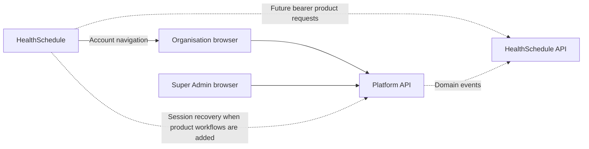

# HealthAlyst frontend architecture

Updated 24 October 2026 for the current NestJS authentication contract. This
records source behavior and remaining product integration boundaries. The
[Platform Swagger reference](https://healthalyst-platform-api-dev.onrender.com/docs/swagger/?urls.primaryName=Platform)
and backend contracts define the API; frontend transport does not redefine it.

## App ownership

| App                         | Responsibility                                                                          | Current integration                                                                                                     |
| --------------------------- | --------------------------------------------------------------------------------------- | ----------------------------------------------------------------------------------------------------------------------- |
| Organisation hub, port 3005 | Common registration, account authentication, organisation onboarding and administration | Registration, email confirmation, MFA, password recovery, application status, auth and organisation-management services |
| HealthSchedule, port 3006   | Scheduling product spoke                                                                | Entry links to the organisation hub; product workflows remain unimplemented                                             |
| Super Admin, port 3007      | HealthAlyst internal platform staff and organisation review                             | Staff MFA and Platform realm, organisation queue/detail/review operations                                               |

Apps share packages, not React state or query caches. No app imports another
app's source. Pending organisations stay in the application journey. Platform
staff and organisation employees have separate roles and backend permissions.

Local `/v1` requests can pass through a transport-only Next.js rewrite to Render.
On deployed same-site origins, browser calls may reach the Platform API directly.
Both arrangements use the same backend-owned refresh-cookie and bearer contract.
See [authentication](authentication.md) for the complete transport lifecycle,
configuration, failure handling, and migration requirements.

## Shared foundations

`@healthalyst/platform-api` owns stable authentication response schemas, typed
services, the browser credential/refresh lifecycle, product bearer-client factory,
and the fixed Next.js transport rewrite. Each app supplies its own environment
configuration and owns its identity provider and feature services.

`@healthalyst/ui` owns neutral shadcn primitives and reusable visual compositions.
`@healthalyst/icons` owns semantic icon exports. ESLint, TypeScript, and test
packages contain shared tooling. See [code organisation](code-organization.md)
for feature folders and dependency direction.

## Authentication and context

Password sign-in returns `mfaToken` or `enrolmentToken`. MFA verification or
initial TOTP confirmation returns a bearer token and sets the API refresh cookie.
Email verification can return an enrolment token. The shared transport captures
access tokens in memory; identity snapshots returned to React do not include them.
Reload restoration refreshes and reads `/v1/me`, preserving wildcard branch scope.

The transport coordinates refresh per tab, replaces tokens after step-up/context
changes, and retries once only for explicit authentication expiry. It does not
retry arbitrary writes, log tokens, persist credentials, or transfer tokens
between apps. Refresh failures that are not invalid authentication remain
recoverable. Providers clear caches on account/context changes and ignore stale
restoration results after a completed sign-in or logout.

The backend auto-selects a single membership. Multiple memberships require an
organisation choice. Staff with no memberships enter the Platform realm; staff
with memberships can switch to `{ realm: "PLATFORM" }`. An organisation ID in a
query key does not select backend context. The context endpoint must issue the
replacement token first. Product APIs enforce enabled-product audiences and do
not accept Platform staff tokens.

## Integration boundaries

The shared package provides all 20 existing user-facing auth operations: login,
MFA verify, TOTP setup/confirm, recovery-code regeneration, step-up, refresh,
context switch, logout/logout-all, session list/revoke, email verify/resend,
phone send/verify, password forgot/reset/change, and `/v1/me`. The hub and staff
apps expose their existing sign-in, MFA, recovery, and logout journeys; account,
phone, session-management and context-selection screens are not all connected.

The hub owns services for onboarding application reads/edits, presigned upload,
storage upload, document confirmation/removal, and submission. Organisation
profile, branch, capability, and department operations have services/hooks;
dedicated management views remain separate work. Uploads use storage URLs and
returned headers without attaching Platform credentials. Versioned updates
retain `If-Match` conflict handling.

Super Admin owns the organisation directory, details, claim/release, secure
view URLs, change requests, checklist approval, and rejection. Additional staff,
organisation-member, invitation, partner, and lifecycle screens depend on their
product workflows.

HealthSchedule's existing entry page links to the hub. A product workflow should
restore its own Platform token through the backend cookie, then use the shared
product-client factory for its own API boundary. Product access still requires
`GET /v1/organization` and backend permission checks. The current product API
contract does not supply scheduling or laboratory business operations that can
be invented by the frontend.

## Remaining product decisions

Organisation/branch selection, the active-organisation home, safe product-return
navigation, and the product launcher still need complete journeys. Do not put
bearer tokens in navigation URLs or assume importing a shared package creates
cross-app SSO. Backend cookie availability depends on the configured browser
origins; localhost ports do not isolate cookies.

Automated transport/contract tests and repository gates are the executable
verification evidence. Browser checks using simulated API responses establish
frontend behavior, while authenticated deployed journeys require real backend
accounts and environment configuration. Successful compilation alone does not
establish a complete live onboarding or product journey.
