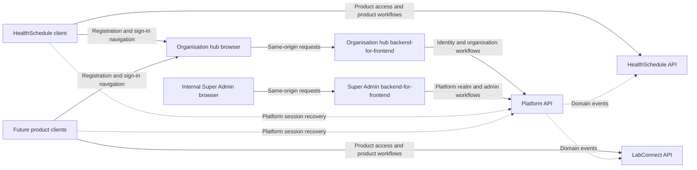

# HealthAlyst frontend architecture analysis

Review date: 23 October 2026. This records the hub-and-spoke architecture and the implementation in this working tree; the live NestJS Platform Swagger contract is the API source of truth.

For the current source layout following the module refactor, see
[code organisation](code-organization.md). The Swagger observations below are
from the original review; the organisation refactor did not re-fetch live specs.

## Evidence and scope

The frontend is on `feat/platform-registration`, with existing uncommitted changes. This review distinguishes the intended app boundaries from which clients and API flows are currently implemented.

The review covers all three application workspaces, their routes, API clients, authentication and query providers, workflow components, configuration, all six shared packages and their responsibilities, shared compositions and exports, repository guidance, and continuous integration configuration. This is an architecture and contract review rather than an accessibility audit or a line-by-line review of every shared primitive.

The live API reference was authenticated using credentials supplied earlier in the conversation. Credentials and account data are excluded from this report. The Platform, HealthSchedule, and LabConnect OpenAPI documents were retrieved from the deployed Swagger documentation:

| Document                                                                                             | Version | Paths | Operations |
| ---------------------------------------------------------------------------------------------------- | ------- | ----- | ---------- |
| [Platform](https://healthalyst-platform-api-dev.onrender.com/docs/platform.openapi.json)             | 1.0.0   | 77    | 88         |
| [HealthSchedule](https://healthalyst-platform-api-dev.onrender.com/docs/healthschedule.openapi.json) | 1.0.0   | 5     | 5          |
| [LabConnect](https://healthalyst-platform-api-dev.onrender.com/docs/labconnect.openapi.json)         | 1.0.0   | 5     | 5          |

NestJS is the primary backend for the frontend apps. The [Platform Swagger reference](https://healthalyst-platform-api-dev.onrender.com/docs/swagger/?urls.primaryName=Platform) defines the shared authentication, organisation, onboarding and staff-review calls described here. Product-specific API contracts remain separate spokes for their own business workflows.

No live login, registration, upload, review decision or other business mutation was performed during this review. CORS preflight checks were made against the dev Platform API. The implementation state below reflects the current frontend working tree, not a production deployment.

## 1. The architecture

HealthAlyst has a shared organisation hub, independently deployed product spokes, and a separate internal administration client. All of them use a central Platform identity and organisation model. Product APIs implement their own business domains and consume platform events.



This diagram describes the ownership model implied by the existing hub links and documented API boundaries. Several integrations in it remain unimplemented. It does not imply that the current product APIs already expose scheduling or laboratory business workflows.

A monorepo shares source packages and tooling. Each Next.js app still has its own build, origin, root layout, React state and query cache. Mounting a provider in the organisation app cannot preserve a token in the HealthSchedule or Super Admin app. Navigation between apps therefore needs a deliberate session recovery and return-destination design.

### Application ownership

| Workspace                                                                                                                  | Owns                                                                                                                                         | Current implementation                                                                                                                                                        |
| -------------------------------------------------------------------------------------------------------------------------- | -------------------------------------------------------------------------------------------------------------------------------------------- | ----------------------------------------------------------------------------------------------------------------------------------------------------------------------------- |
| [Organisation hub](/home/i19n/Documents/development/company/healthAlyst/healthalyst-frontend/apps/organization/README.md)  | Common registration, verification and authentication; organisation onboarding; shared organisation administration and enabled-product access | Registration, email confirmation, MFA, refresh-based session restoration, and application status screens; Platform services for auth and organisation management              |
| [HealthSchedule](/home/i19n/Documents/development/company/healthAlyst/healthalyst-frontend/apps/health-schedule/README.md) | Scheduling and clinical operations inside the selected, authorised organisation                                                              | A product entry page linking to the hub. No scheduling workspace or product API client yet                                                                                    |
| [Super Admin](/home/i19n/Documents/development/company/healthAlyst/healthalyst-frontend/apps/super-admin/package.json)     | HealthAlyst's internal organisation review, platform staff and lifecycle operations                                                          | NestJS Platform API authentication, platform realm and admin organisation review routes                                                                                       |
| LabConnect / PharmaDesk                                                                                                    | Separate product spokes when implemented                                                                                                     | Product choices exist in registration. Neither has a frontend workspace. LabConnect has an API specification; no PharmaDesk specification is advertised by the live reference |

Organisation employees and HealthAlyst platform staff are different actors. `/v1/staff` and `/v1/roles` manage the selected organisation's employees and permissions. `/v1/admin/staff` manages HealthAlyst's own platform staff. Super Admin must use the `PLATFORM` realm; product APIs accept organisation product access rather than platform staff tokens.

### Shared packages

| Package                          | Responsibility                                                                                                                                          |
| -------------------------------- | ------------------------------------------------------------------------------------------------------------------------------------------------------- |
| `@healthalyst/ui`                | Product-neutral shadcn primitives and reusable compositions: action buttons, forms, dashboard shell, split-panel layouts, QR display and other controls |
| `@healthalyst/icons`             | Semantic icon exports; owns the Tabler dependency                                                                                                       |
| `@healthalyst/eslint-config`     | Shared lint rules and Next.js configuration                                                                                                             |
| `@healthalyst/typescript-config` | Shared strict compiler presets                                                                                                                          |
| `@healthalyst/test-utilities`    | Testing Library setup exposed for future consumers                                                                                                      |
| `@healthalyst/platform-api`      | Shared Platform API contract and same-origin backend-for-frontend handler; server-side encrypted sessions and browser-safe auth services                |

There are six shared package workspaces and three application workspaces, for nine workspaces in total.

The installed application stack is Next.js 16.3.8, React 19.2.4, TypeScript 5.9.3 and Tailwind 3.4.19. pnpm 10.27.0 is pinned. Axios and TanStack Query are dependencies of the organisation and Super Admin apps. HealthSchedule currently needs neither because it only renders links. App manifests do not depend on other apps. Shared packages do not supply cross-application session persistence.

## 2. Current route inventory

Paths below are relative to each independent application origin.

| App            | Route            | Behaviour                                                                                                    |
| -------------- | ---------------- | ------------------------------------------------------------------------------------------------------------ |
| Organisation   | `/`              | Three-step registration and its check-email confirmation view; `?product=` preselects product interest       |
| Organisation   | `/verify-email`  | Email confirmation, resend and conditional MFA enrolment/recovery-code screens                               |
| Organisation   | `/sign-in`       | Password, authenticator/recovery-code challenge, conditional MFA enrolment and recovery-code acknowledgement |
| Organisation   | `/application`   | Authenticated application workspace; restores its session with refresh and `GET /v1/me` after reload         |
| HealthSchedule | `/`              | Product introduction with registration and sign-in links to the hub                                          |
| Super Admin    | `/`              | Redirects to `/dashboard`                                                                                    |
| Super Admin    | `/sign-in`       | Password, authenticator/recovery-code verification, and first-use authenticator setup                        |
| Super Admin    | `/dashboard`     | Platform organisation and review metrics                                                                     |
| Super Admin    | `/organizations` | Platform organisation list with server-side search                                                           |
| Super Admin    | `/review`        | Claim/release, document viewing, itemised change requests, checklist approval and rejection                  |

The hub has `/forgot-password` and `/reset-password` screens. It still has no organisation/product home, organisation switcher, product launcher, profile/branch/role/member/partner routes or invitation acceptance page.

Moving the application display onto `/application` addresses its route placement. The next destination after sign-in still needs to be chosen from identity, context, organisation status and product access. An unconditional application redirect cannot represent the complete hub journey.

The new application layout still uses a centred `SplitPanelLayout` with the showcase disabled and a brand header. The authenticated hub needs a layout that supplies the selected organisation, relevant navigation, account controls and product destinations across its authenticated routes. The existing product-neutral dashboard composition is available for reuse; the hub's navigation and behaviour belong to the organisation app.

## 3. API ownership and current integration

| API area               | Frontend owner | Current implementation                                                                                                                                       |
| ---------------------- | -------------- | ------------------------------------------------------------------------------------------------------------------------------------------------------------ |
| Auth                   | Shared         | All 20 user-facing Platform auth operations have services in `@healthalyst/platform-api`; the organisation hub and Super Admin use the same session contract |
| Onboarding             | Organisation   | Registration and application read are integrated; profile edits, document upload/removal and submission remain                                               |
| Reference              | Organisation   | Policy versions, organisation types and Nigerian states have Platform service hooks                                                                          |
| Admin organisation     | Super Admin    | NestJS Platform list, detail, claim/release, secure document URLs, change requests, approval and rejection are integrated                                    |
| Organisation           | Organisation   | All eight profile, branch, capability and department API operations have services and query hooks; dedicated management screens are not yet connected        |
| Admin staff            | Super Admin    | The staff sign-in flow uses the Platform auth contract; staff account/role administration screens are not integrated                                         |
| Roles, Staff, Partners | Organisation   | No corresponding management screens or endpoint services yet                                                                                                 |
| Health / Operations    | Infrastructure | Health checks, event relay and public JWKS are not applicant workflows                                                                                       |

The Platform auth service covers all 20 user-facing authentication operations. The public JWKS endpoint is an infrastructure contract and is not part of an applicant or staff screen. Endpoint service coverage does not mean every operation has a user-facing screen.

Each current product specification contains one user-facing product-access read (`GET /v1/organization`), one internal event ingestion operation and three health operations. The reviewed specifications do not yet provide appointment, patient, laboratory-order or result operations. Those business interfaces cannot be inferred from the product names.

## 4. Authentication and context must drive navigation

### The documented session

1. Password login returns `MFA_REQUIRED` or `MFA_ENROLMENT_REQUIRED`.
2. A valid second factor or confirmed enrolment returns an access token and sets the API refresh cookie. The backend-for-frontend captures both server-side, strips credential fields from the browser response, and sets an opaque host-only session cookie. Recovery codes are shown once and acknowledged before proceeding.
3. Access and refresh tokens never reach browser JavaScript. The backend-for-frontend encrypts them in Redis; the browser stores an opaque `HttpOnly; Secure; SameSite=Strict` session identifier. For the active MFA or authenticator-enrolment step, the backend-for-frontend also keeps the API's short-lived challenge token in a separate `HttpOnly; Secure; SameSite=Strict` cookie scoped to `/api/platform/v1/auth`; the UI receives only the challenge state, not the credential.
4. On reload or near access-token expiry, the app calls `GET /v1/me` through its backend-for-frontend. The backend-for-frontend performs a single-flight `POST /v1/auth/refresh`, sends the stored refresh cookie plus the app origin and `X-Requested-With: healthalyst`, and rotates the stored tokens.
5. Load `GET /v1/me` to rebuild the user, memberships, active context, permissions, branch scope and platform roles.
6. Choose organisation/branch through `POST /v1/auth/context`. A platform staff member can enter `{ realm: "PLATFORM" }`.
7. Step-up authentication issues a replacement token for sensitive actions. Logout also requires credentials so cookie removal is applied.

The backend auto-selects the organisation when there is exactly one membership. Several memberships start without an organisation context. Platform staff with no organisation memberships initially enter the platform realm. A person with both kinds of access needs an explicit realm choice when moving to internal administration.

### Current implementation

The shared `@healthalyst/platform-api` package exposes browser-safe auth services and a Node.js backend-for-frontend handler. The organisation and Super Admin apps each have their own same-origin `/api/platform/[...path]` route and host-only cookies. The backend-for-frontend never forwards a browser-supplied `Authorization` or `Cookie` header, never forwards API `Set-Cookie`, strips access, refresh, ID, MFA, and enrolment token fields from JSON responses, attaches its server-held access token to protected requests, and keeps refresh traffic inside the server. It injects MFA and enrolment credentials from the short-lived HttpOnly challenge cookie into the required NestJS request bodies. Unsafe browser requests must have the exact configured app `Origin` and `X-Requested-With: healthalyst`. API refresh uses the same headers and an unset content type for its bodyless request.

The organisation hub and Super Admin keep separate backend-for-frontend sessions, React providers and query caches because they are separate apps and origins. The app-specific `__Host-` cookie stays scoped to its own host, and the backend-for-frontend clears cached user data on sign-out, session expiry, and account or organisation-context changes. The backend-for-frontend does not pass tokens between apps and does not proxy one app through another. Cross-app sign-in remains a separate SSO decision; each app establishes its own session.

The shared service also exposes context switching, step-up, session listing/revocation, password reset/change, phone verification and recovery-code management. Those operations are available to product flows but do not all have screens yet. Sign-in destinations still need to branch on identity, active context, organisation status and product access; `/application` is the pending-organisation workspace, not the permanent home for every authenticated user.

An organisation ID in a query key does not select the API context. Context selection must call `POST /v1/auth/context`; the backend-for-frontend stores the returned bearer token and uses it for subsequent protected requests.

## 5. The complete organisation journey

```text
Register -> confirm email -> enrol MFA -> acknowledge recovery codes
  -> selected organisation's DRAFT application
  -> complete profile, verify phone, upload/confirm required documents
  -> submit when canSubmit is true
  -> PENDING_VERIFICATION -> UNDER_REVIEW
       -> CHANGES_REQUESTED -> correct and resubmit
       -> REJECTED
       -> ACTIVE -> refresh identity/context -> enabled product access
```

The initial registration response is deliberately non-enumerating: `202 PENDING_EMAIL_VERIFICATION` does not confirm that an account was newly created. Verification and MFA do not submit the application for review.

The application API supplies `canEdit`, `canSubmit`, checklist items, document requirements, scan states and reviewer messages. The current screen displays the checklist, document states and messages. It parses `canEdit` and `canSubmit` but does not use them to expose working actions. Save, phone verification, upload, removal and submission operations are missing. The confirmation screen also jumps from MFA to review in its next-step copy, omitting application completion and submission.

`PENDING_VERIFICATION` means submitted and waiting for review in this lifecycle. The current description, “Confirm the administrator details to continue,” misrepresents that state.

Document upload has three distinct steps: request a presigned URL; PUT the file directly to storage using only its returned headers; confirm the document with Platform for validation and malware scanning. Product and Platform bearer credentials must not be attached to the storage request. Clean uploads, reviewer acceptance and a fully approved organisation are separate states.

Profile edits must preserve versions and send `If-Match`; `412` needs conflict recovery and `428` indicates a missing precondition. Backend `canEdit` and `canSubmit` should control the actions. Draft, requested-changes, submitted, under-review and final states need their corresponding reachable actions and recovery paths.

## 6. Product access is a separate transition

The [HealthSchedule links](/home/i19n/Documents/development/company/healthAlyst/healthalyst-frontend/apps/health-schedule/src/infrastructure/organization-app/organization-app-links.ts:26) pass `?product=healthschedule` during registration. The sign-in link has no originating-product or return destination, and there is no product launcher or return handling in the hub.

After authentication and organisation selection:

- An incomplete application opens its onboarding workspace.
- A submitted application shows review status and messages.
- An active organisation can open enabled products and common management functions according to permissions.
- Each spoke obtains a usable Platform session under the agreed cookie/origin strategy, then calls its product API's `GET /v1/organization` before opening product content.
- Platform staff use internal administration under the platform realm.
- Restricted/terminal organisation states need their status and permitted recovery paths.

After approval, the access token must be refreshed so its organisation status, permissions and product audiences reflect the new state. Product copies update through platform events, so brief synchronisation delay must be handled without presenting unconfirmed access as ready.

Product return routing and cross-app single sign-on are still design work. Any return URL should be constrained to known app destinations. The documented APIs do not establish a browser token-transfer protocol or permit tokens in URLs. Independent app origins cannot share a React provider; each API-calling app should use its own same-origin backend-for-frontend and cookie.

## 7. Super Admin uses the same NestJS Platform API

The organisation hub and Super Admin each run as separate frontend spokes and call the NestJS Platform API through their own same-origin backend-for-frontend. They share the transport and authentication contract through `@healthalyst/platform-api`, while each app keeps its own encrypted server-side session, host-only cookie, React session provider, query cache and route ownership. This adds a server boundary inside each app; it does not make one app a proxy for another or change the hub-and-spoke ownership model.

Super Admin enters the `PLATFORM` realm after MFA and calls `/v1/admin/organizations`. The review journey uses the API's status filters and cursor pagination, claim/release, document detail and short-lived view URLs, itemised change requests, versioned checklist approval and reasoned rejection. Super Admin authentication and organisation review use the same NestJS Platform API as the organisation hub.

The NestJS contract supports itemised reviewer change requests and secure uploaded-document viewing. The frontend uses those operations in its review flow.

## 8. Environment and operational evidence

| App            | Manifest port | Current relevant local target                                                       |
| -------------- | ------------- | ----------------------------------------------------------------------------------- |
| Organisation   | 5173          | Same-origin organisation backend-for-frontend; server calls the NestJS Platform API |
| HealthSchedule | 3000          | Links to the organisation app at localhost:5173; no API calls yet                   |
| Super Admin    | 8080          | Same-origin Super Admin backend-for-frontend; server calls the NestJS Platform API  |

All three Next.js configurations use standalone output and shared-package transpilation. The organisation and Super Admin browsers call their own same-origin backend-for-frontend; those backend-for-frontends call the Platform API from the server. The browser no longer needs Platform API CORS access. Refresh still supplies the app origin and `X-Requested-With: healthalyst` because the backend validates those request headers.

Live preflight evidence from this review, checked against the backend's
currently approved local origins:

| Target                      | Origin                  | Result                                       |
| --------------------------- | ----------------------- | -------------------------------------------- |
| Platform `/v1/auth/refresh` | `http://localhost:3000` | 204; matching origin and credentials allowed |
| Platform `/v1/auth/refresh` | `http://localhost:5173` | 204; matching origin and credentials allowed |
| Platform `/v1/auth/refresh` | `http://localhost:8080` | 204; matching origin and credentials allowed |

These checks were run against the live dev API on 23 October 2026, before the
backend-for-frontend change. They document the old browser-to-API CORS path and are not required
for backend-for-frontend requests. The backend refresh endpoint still validates the app `Origin`
and `X-Requested-With`; its existing allowlist must accept each deployed app
origin. The API's `SameSite=Strict` refresh cookie now stays on the server and
is never a browser dependency.

The backend-for-frontend handles server-side token storage, single-flight refresh, CSRF checks, safe error responses and session restoration. The browser API layer translates Platform's nested errors and field details. Protected organisation updates and Super Admin decisions use version headers through the backend-for-frontend.

## 9. Documentation and verification gaps

- All current shared auth endpoints and organisation-management endpoint services use the NestJS Platform contract. Product apps still need to add their documented API calls as product workflows are built.
- Production backend-for-frontend deployments need a reachable private Redis store and a stable, app-specific session encryption secret shared by every instance; use TLS for remotely hosted Redis. Local development can use the encrypted in-process fallback, though sessions end when the Next.js server restarts.
- HealthSchedule has no product API request yet; it links to the organisation hub for registration and sign-in.
- Shared test setup exists, but no application test scripts, test files or Vitest configuration were found in the tracked source inventory. The CI command invokes `pnpm test-all`; its test stage currently cannot establish application test coverage merely by succeeding.

For this backend-for-frontend update, the shared Platform API package and both affected apps pass TypeScript checks, formatting, lint, and production builds. Tests were not run, and authenticated browser journeys were not exercised. No live API mutations were performed. Production session behavior still depends on Redis and the backend's existing Origin policy being configured for the deployed app origins.

## 10. Recommended implementation order

The current implementation establishes the shared NestJS API layer and initial Platform review journey. Remaining work is:

1. **Finish onboarding actions:** versioned application edits, phone verification in the onboarding view, document upload URL, storage upload, Platform confirmation/removal, submission and requested-change resubmission.
2. **Build the authenticated organisation hub:** organisation and branch selection, profile/branch/member/role/invitation management, product launcher and account settings.
3. **Add the missing auth screens:** password reset request and token-based reset; session and recovery-code management where product requirements call for them.
4. **Complete destination selection:** route by realm, active organisation, status, permissions and enabled products; preserve safe return destinations across spoke navigation.
5. **Connect product APIs:** implement HealthSchedule and LabConnect product calls when their workflows are in scope, while keeping shared identity and organisation ownership with the NestJS Platform API.
6. **Configure and verify the backend-for-frontend runtime:** provide Redis and a stable encryption secret per app, and ensure the backend's refresh Origin/CSRF policy accepts deployed app origins; then browser-check refresh and protected calls on local and deployed subdomains.
7. **Verify full workflows:** run the applicant-to-reviewer-to-applicant journey and cover error recovery, authorization, cache isolation and mobile layouts.

## Appendix: current Platform API integration coverage

This inventory follows the Platform OpenAPI document in Swagger, checked on 23 October 2026. “Service” means a typed API function exists; “screen” means a frontend route currently exposes the workflow.

### Authentication

All 20 user-facing auth operations have typed services in `@healthalyst/platform-api`: login, MFA verify, TOTP setup/confirm, recovery-code regeneration, step-up, refresh, context switch, logout/logout-all, session list/revoke, email verify/resend, phone send/verify, password forgot/reset/change and `GET /v1/me`.

The organisation hub exposes registration, email confirmation, sign-in, MFA enrolment and logout. Super Admin exposes staff sign-in, MFA enrolment and logout. Password-reset, phone-verification, session-management, context-selection and recovery-code-management screens remain to be built where the product journeys require them.

### Organisation onboarding

The hub has services for `POST /v1/onboarding/registrations` and `GET /v1/onboarding/application`. The remaining documented onboarding calls still need connected UI: `PATCH /v1/onboarding/application`, document upload URL, storage upload confirmation, document removal and application submission.

### Organisation management

The organisation hub has services and query hooks for all eight documented operations: profile read/update, branch list/create/update, branch capability replacement, department create and department update. Dedicated organisation-management screens are not connected yet.

### Super Admin review

Super Admin services call NestJS Platform endpoints for organisation search and cursor pagination, detail, claim/release, secure document view URLs, itemised change requests, checklist approval, reasoned rejection, internal notes, suspension, reinstatement and deactivation. The current review screens expose the queue/detail and core claim, release, request-changes, approve and reject actions; the other lifecycle actions still need screens.

### Not yet integrated

- Organisation roles, staff/member administration, invitations and partners.
- HealthSchedule's `/v1/organization` product-access check and its product workflows.
- LabConnect's `/v1/organization` product-access check and its product workflows.
- Infrastructure operations such as event relay, health checks and JWKS are outside user-facing app flows.

The NestJS Platform API remains the shared authority for identity, organisation context and platform review. Product APIs can serve product-specific workflows when those features are implemented; each frontend app owns its API boundary, with browser session-bearing calls passing through that app's same-origin backend-for-frontend.
